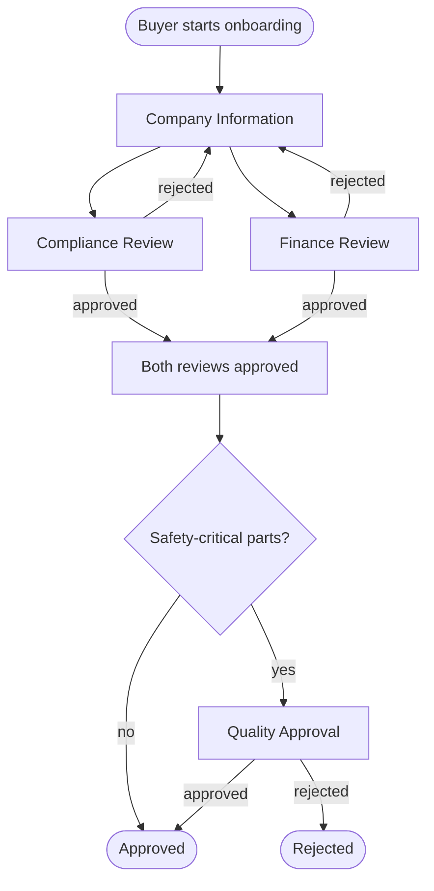

# Supplios Take-Home Challenge: A Workflow Engine

Thanks for taking the time to do this. Please read the whole page before you start.

## What this exercise is for

Workflows are at the core of the Supplios platform, so we want to see how you think about them. The code you hand in is only part of what we look at. We want to understand three things:

1. **How you approach a problem.** What you model, what you leave out, and what you ask about.
2. **How you make decisions.** Which options you saw, which one you picked, and why.
3. **How you work with AI.** What tools you use, what you ask it for, what you accept, what you push back on, and how you check its work.

We expect you to use AI coding tools for this, the same way you would on the job.  (and the same way we iterated on this take-home challenge!) That means a working solution on its own tells us very little, and a rough solution with clear thinking behind it tells us a lot.

(You may also decide not to use AI coding tools for this, but honestly, that wasn't what we had in mind, and it isn't how we work on a daily basis.  And if you hand-code this, it's probably going to take much more time than we expected.)

You may well finish with a solution you are not fully happy with. That is fine, and it is useful: tell us what you do not like about it and what you would change. We would much rather read that than have it hidden.

One rule: you are responsible for everything you submit. "The AI wrote it that way" is a fair description of how the code got there, but it is not a reason for the code to stay that way.

## The process

| Step | What you do | Details |
|---|---|---|
| 1 | **Read this page** and ask us anything that is unclear. | Send questions to the person who sent you this challenge. Questions are welcome. |
| 2 | **Build your solution**, using whatever AI tools you normally work with. | Plan for 1 to 2 hours. See [The challenge](#the-challenge). |
| 3 | **Keep two records as you go**: your AI transcript and a short decision log. | See [What to submit](#what-to-submit). These matter as much as the code. |
| 4 | **Submit** the code and both records. | See [How to submit](#how-to-submit). |
| 5 | **Come in for a face-to-face interview & follow-up session.** You bring your laptop to our office (or share your screen if we are doing this remotely), walk us through your solution, and make some changes to it with us.  We'll combine this with a normal face-to-face interview, so 2 birds, 1 stone. | See [The follow-up session](#the-follow-up-session). |

If you run out of time in step 2, stop. Write down what is missing and what you would do next. An unfinished solution with an honest note is a perfectly good submission.

## Background

At Supplios, a workflow is a long-running business process between a manufacturer and its suppliers: onboarding a new supplier, resolving a quality issue, approving a part for production. These processes run for days or weeks. They involve people from more than one company, they have work happening in parallel, and they regularly go backwards when something is rejected. Each of our customers runs its own versions of these processes, and many of them are in progress at the same time.

So the software problem has two halves. How do you describe a process like that? And how do you keep track of every individual one that is currently in progress?

## The challenge

Build a small workflow engine, and use it to run the supplier onboarding process described below.

There is no requirement for a UI or web API. (but fine if you added them)  A script, a command-line program, or a set of tests that runs the [scenarios](#scenarios) and prints what happened is all we need.

### The process to model: supplier onboarding

A manufacturer wants to start buying from a new supplier. Before that can happen, the supplier has to provide some information, and a few people at the manufacturer have to review it.

**Who is involved**

| Person | Company | What they do |
|---|---|---|
| Buyer | Manufacturer | Starts the onboarding. Can cancel it. |
| Supplier contact | Supplier | Fills in the company information. |
| Compliance reviewer | Manufacturer | Approves or rejects the Compliance Review. |
| Finance reviewer | Manufacturer | Approves or rejects the Finance Review. |
| Quality manager | Manufacturer | Approves or rejects the Quality Approval. |

**How it goes**

1. The buyer starts an onboarding for a supplier.
2. The supplier contact completes the **Company Information** task. The information includes at least a company name, a tax ID, and whether the supplier will provide safety-critical parts (yes or no).
3. Once the company information is submitted, two reviews start at the same time: the **Compliance Review** and the **Finance Review**. Each reviewer either approves, or rejects with a reason.
4. If a review is rejected, the supplier contact has to correct the company information and submit it again. They can see the reason for the rejection.
5. Once both reviews are approved:
   - if the supplier does **not** provide safety-critical parts, the onboarding is **Approved**;
   - if the supplier **does** provide safety-critical parts, a **Quality Approval** task starts for the quality manager.
6. If the quality manager approves, the onboarding is **Approved**. If the quality manager rejects, the onboarding is **Rejected**, and that is the end of it.
7. The buyer can **cancel** the onboarding at any point before it has ended.



The diagram shows the business process, not a design. Cancelling is not shown. Approved, Rejected and Cancelled are the three ways an onboarding can end; what you call everything in between is up to you.

### What your engine must do

These are behaviors, not components. Which classes, tables or concepts you use to get there is your decision, and it is the main thing we want to talk to you about.

1. **One description, many onboardings.** The onboarding process is described once. Any number of onboardings can then be started from that description, each with its own data and its own progress. They do not affect each other, and they do not change the description. It should be possible to read the description and understand the process without reading the engine code.
2. **The engine is not about onboarding.** Describe a second, different process of your own choosing (two or three steps is enough) and run it on the same engine, without changing the engine.
3. **Work is connected.** Something finishing in one place makes things happen elsewhere: tasks start, the onboarding as a whole moves forward. This includes work that runs in parallel, waiting for all of it to finish, and choosing a path based on the data of that particular onboarding.
4. **Things can go backwards.** A rejection sends work back to an earlier point, and the same task can be done more than once.
5. **Not everything is allowed.** The engine refuses an action that makes no sense right now (approving a review that has not started, completing a task on a cancelled onboarding). It also refuses an action from someone who is not allowed to perform it (the supplier contact approving the Finance Review). A refused action leaves everything exactly as it was.
6. **You can see where things stand.** For any onboarding you can ask: what is its overall status, which tasks are open, and who is each one waiting for?
7. **You can see how it got there.** For any onboarding you can show what happened, in order: who did what, and what the engine did as a result. Things the engine did on its own (such as starting the two reviews) are part of that history.

There is no real authentication. An action only needs to say who is performing it, for example with a name and a role.

### Things we have deliberately left open

The description above has gaps, and they are intentional. For example:

- One review is rejected while the other is still open, or has already been approved. What happens to the other one?
- After the supplier contact resubmits, which reviews happen again?
- The buyer cancels while tasks are open. What happens to those tasks?
- Do refused actions belong in the history?

These are not the only gaps. When you find one, pick an answer, build it, and note it in your decision log. We are not hoping for one particular answer. We want to see that you noticed the question and can explain your choice.

### Scenarios

Your solution should be able to run these and show the result of each step. "Refused" means the engine rejects the action and nothing changes.

**Scenario 1: straight through**

1. The buyer starts an onboarding for "Acme Fasteners". *Then:* the supplier contact has an open Company Information task. No reviews are open.
2. The supplier contact submits the company information (safety-critical: no). *Then:* the Compliance Review and the Finance Review are both open.
3. The compliance reviewer approves. *Then:* the Finance Review is still open and the onboarding is not Approved yet.
4. The finance reviewer approves. *Then:* the onboarding is Approved and no tasks are open.

**Scenario 2: a second onboarding that takes a different path**

1. The buyer starts a new onboarding for "Acme Fasteners" and leaves it waiting on the Company Information task. The buyer then starts an onboarding for "Bolt Dynamics" from the same description.
2. For Bolt Dynamics, the supplier contact submits the company information (safety-critical: yes), and both reviews are approved. *Then:* a Quality Approval task is open for the quality manager. The Bolt Dynamics onboarding is not Approved yet.
3. The quality manager approves. *Then:* the Bolt Dynamics onboarding is Approved.
4. *Throughout:* the Acme Fasteners onboarding is still exactly where it was left in step 1.

**Scenario 3: rejection and rework**

1. An onboarding has both reviews open. The finance reviewer rejects with the reason "Tax ID does not match". *Then:* the supplier contact has an open Company Information task again, and can see the reason.
2. The supplier contact corrects the tax ID and submits again. *Then:* whichever reviews your design calls for are open again.
3. Everything is approved. *Then:* the onboarding is Approved, and its history shows both submissions and the rejection.

**Scenario 4: refused actions**

1. The compliance reviewer tries to approve the Compliance Review before the supplier contact has submitted anything. *Then:* refused.
2. With both reviews open, the supplier contact tries to approve the Finance Review. *Then:* refused.

**Scenario 5: cancelling**

1. An onboarding has both reviews open. The buyer cancels it. *Then:* the onboarding is Cancelled.
2. The compliance reviewer tries to approve the Compliance Review. *Then:* refused.

**Scenario 6: a different process**

1. Start and complete one run of your own second process on the same engine.

**Scenarios 7 and 8: yours**

Add two scenarios of your own: the two cases you think are most likely to break your design. It is fine if one of them fails right now. Tell us which, and why.

### Out of scope

- A user interface or a web API (although including them is totally fine)
- A real database. Keeping everything in memory is fine, though we may ask you what you would store and how.
- Real authentication, real emails, deployment.
- Production-level error handling and performance.

## What to submit

Three things. The second and third matter as much as the first.

### 1. The code

- Any language you like. Python is slightly preferred, since that is what our backend is written in.  Typescript would be next most preferred.  Then probably FORTRAN. (that's a joke)
- Short instructions for running it, ideally one command that runs all the scenarios.
- Tests are welcome if they are how you would naturally check your work. They are not required.

### 2. Your AI transcript (`AI_TRANSCRIPT.md`)

A copy and paste from your coding tools of the main prompts you wrote and the agent's responses to them, in the order they happened.

- **Include** the exchanges where you set the direction, where the agent proposed an approach, and where you corrected it or changed course. Dead ends and corrections are exactly what we want to see.
- **Leave out** full diffs, file contents and tool output. Replace them with a short note such as `[diff omitted]`. You can also skip routine back-and-forth.
- **Do not tidy it up.** Paste your prompts as you wrote them, typos included. Please do not rewrite them afterwards or ask a model to summarize the session.
- If you used more than one tool or session, include each one with a label saying which tool and model it was.
- Remove any secrets or personal information.

If you did part of the work without AI, or all of it, say so here and tell us why. That is a decision too.

### 3. Your decision log (`DECISIONS.md`)

Please write this one yourself. Bullet points and rough wording are fine; we would rather read five honest sentences from you than five polished paragraphs from a model. This document is the agenda for the follow-up session.

**Three to five design decisions.** Choose the ones that shaped your solution the most. For each:

```markdown
## Decision: <short title>

- **What I decided:**
- **What else I considered:**
- **Why I went this way:**
- **What would make me change my mind:**
```

**Then four short sections:**

- **The open questions.** How you answered the gaps listed [above](#things-we-have-deliberately-left-open), and any others you found.
- **Where I overruled the AI.** At least one thing the AI proposed that you rejected or changed, and why.
- **What I do not like about this solution.** What you would change with more time, and what you think would break first if this had to handle thousands of onboardings across many customers.
- **My two scenarios.** Why you picked scenarios 7 and 8.

### How to submit

Either of these:

- Send us a link to a public repository, or invite the GitHub user `hamblin` to a private one.
- Send us a .zip of the project.

## The follow-up session

After you submit, we will invite you to our office for a face-to-face session. Bring the laptop you built your solution on. If we are doing this remotely, you will share your screen instead.

In the session:

1. **You walk us through your solution**, using your decision log as the outline.
2. **We ask about your decisions**: the ones in your log, and probably a few you did not write down.
3. **You make some changes to your solution.** We will bring one or two new requirements, and you will work them into your code while we watch and talk. Use whatever tools you normally use, AI included. We are interested in how you decide where a change belongs and how you direct and check your tools, not in typing speed.
4. **We may ask you to predict.** For a sequence of events we give you, what will your engine do? Then we run it and see.

To prepare, make sure that your solution runs on the laptop you bring, that you can run your scenarios quickly, and that your coding tools are installed and signed in. You do not need to prepare anything else.

## What we look at

| We care about | We care much less about |
|---|---|
| How you modeled the problem: which concepts you chose and how you kept them apart | How much code there is |
| Whether you can explain each decision and the alternative you turned down | Polish, frameworks and tooling choices |
| How you directed the AI, and how you checked what it gave you | Whether every scenario passes |
| Whether you noticed the open questions and took a position | Whether your answers to them match ours |
| How easily you can change your solution in the follow-up session | Whether the solution was "finished" when you submitted it |
| Whether you can say what is wrong with your own solution | |

Good luck, and thanks again.
